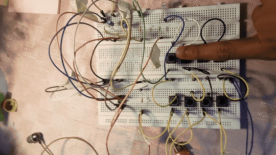
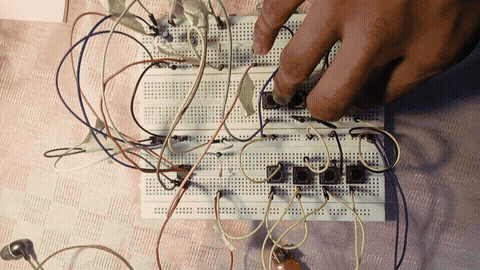
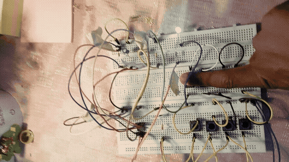
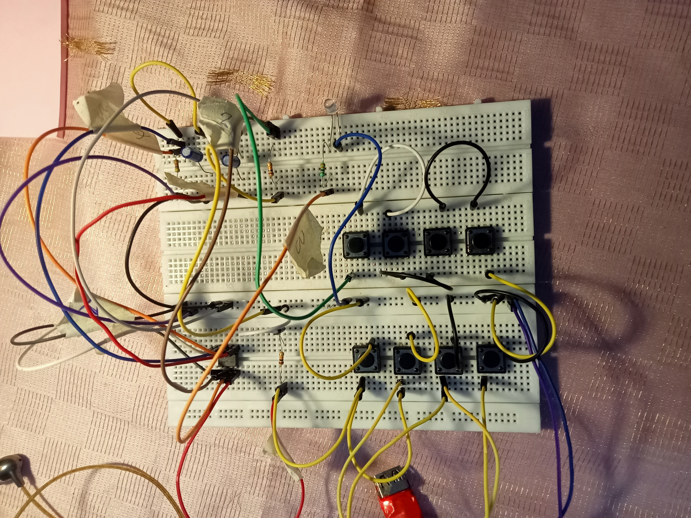
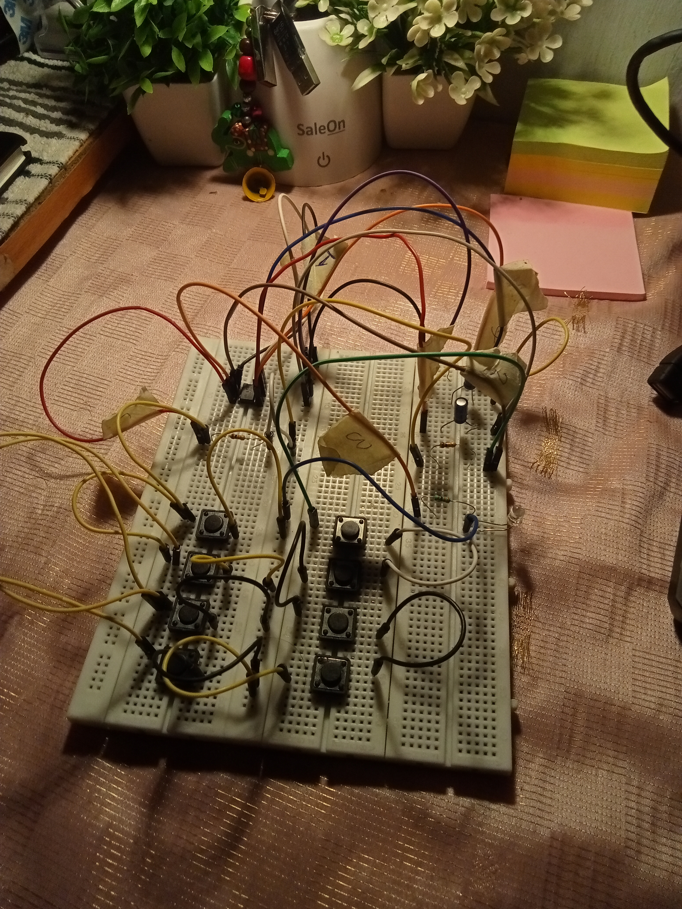
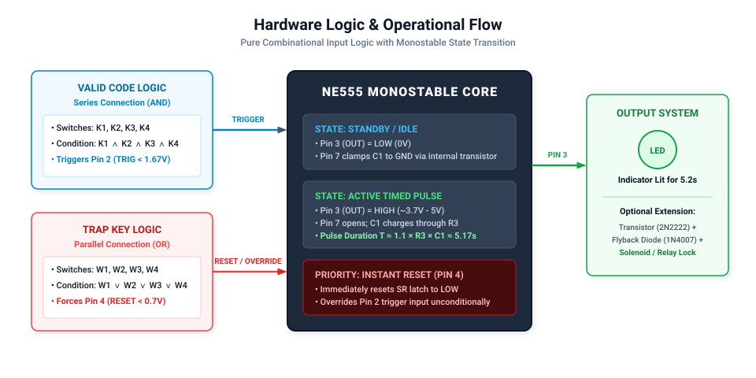
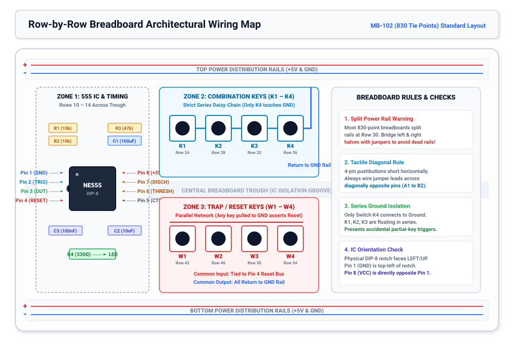
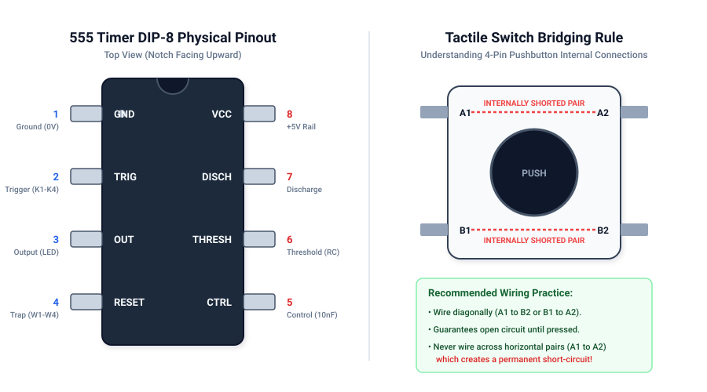

# 🔐 4-Key Combination Lock Using 555 Timer

[](./assets/images/breadboard_top_view.jpg)
[](./docs/SCHEMATIC.md)
[-orange?style=for-the-badge)](./docs/SCHEMATIC.md)
[](./docs/BOM.md)
[](./docs/CALCULATIONS.md)
[](./LICENSE)

A pure hardware, non-programmable electronic combination lock built on a solderless breadboard using an **NE555 / HLF555 timer IC in monostable multivibrator mode**, powered by a regulated **5V DC supply**.

No microcontrollers, no firmware, and no code—just pure analog and combinational hardware logic!

---

## 📑 Table of Contents

- [✨ Key Features](#-key-features)
- [🎬 3-Second Action Demo](#-3-second-action-demo)
- [📐 Clean Schematic & Logic Flow](#-clean-schematic--logic-flow)
- [🗺️ Row-by-Row Breadboard Wiring Map](#️-row-by-row-breadboard-wiring-map)
- [⚙️ How It Operates](#️-how-it-operates)
- [📌 Component & Pin Assignment](#-component--pin-assignment)
- [🛠️ Engineering Challenges & Debugging](#️-engineering-challenges--debugging)
- [🧮 Timing Calculations](#-timing-calculations)
- [📋 Bill of Materials (BOM)](#-bill-of-materials-bom)
- [🔌 Actuator Extension: Driving a Solenoid / Relay](#-actuator-extension-driving-a-solenoid--relay)
- [🌐 Interactive Simulation](#-interactive-simulation)
- [📂 Repository Structure](#-repository-structure)
- [📄 License](#-license)

---

## ✨ Key Features

- **Pure Hardware Logic:** Operates entirely through passive components, switches, and a standard 555 timer. Immune to firmware crashes, buffer overflows, and software bugs.
- **Simultaneous 4-Key Combination ($K_1–K_4$):** Requires pressing all four correct pushbuttons simultaneously to complete the ground path and pull Pin 2 (TRIGGER) below $\frac{1}{3} V_{CC}$.
- **Timed Lock Release:** Once triggered, Pin 3 (OUTPUT) drives an indicator LED (or relay/solenoid) HIGH for **approximately 5.2 seconds** before automatically re-locking:
  $$T \approx 1.1 \times R_3 \times C_1 = 1.1 \times 47\text{ k}\Omega \times 100\ \mu\text{F} \approx 5.17\text{ s}$$
- **Instant Reset / Trap Keys ($W_1–W_4$):** Four decoy tactile switches wired in parallel directly to Pin 4 (RESET). Pressing any wrong key pulls Pin 4 to 0V, immediately shutting off the output and aborting the timing cycle.
- **Tamper & Brute-Force Defense:** Holding any wrong key overrides the trigger unconditionally. An attacker attempting to press all 8 buttons at once will pull the active-low RESET pin low, permanently disabling the lock while pressed.
- **Power Rail & Control Voltage Decoupling:** Incorporates $C_2$ ($10\text{ nF}$) on Pin 5 and $C_3$ ($100\text{ nF}$) across the power rails to eliminate false triggering from output switching transients.

---

## 🎬 3-Second Action Demo

The entire circuit logic demonstrated in under 4 seconds—valid combination trigger followed by instantaneous trap lockout:



- **Step 1: Pressing $K_1–K_4$ together $\rightarrow$ LED turns ON for ~5.2 seconds.**
- **Step 2: Pressing any wrong key ($W_1–W_4$) $\rightarrow$ LED resets INSTANTLY.**

### Extended Demonstration Clips:
| 1. Valid 4-Key Entry & Timed Unlock (~5.2s) | 2. Trap Key Press & Instant Reset Override |
| :---: | :---: |
|  |  |
| *Pressing K1-K4 pulls Pin 2 low; LED remains ON for ~5.2s* | *Pressing wrong key pulls Pin 4 low; resets output immediately* |

> 📹 *A web-optimized 720p MP4 demonstration video is available at [`assets/media/lock_demo_720p.mp4`](./assets/media/lock_demo_720p.mp4).*

---

## 📸 Physical Breadboard Implementation

| Top-Down View | Perspective Layout |
| :---: | :---: |
|  |  |
| *DIP-8 555 IC with taped pin tags, series & parallel keys* | *Breadboard rails, capacitors, and USB 5V power leads* |

---

## 📐 Clean Schematic & Logic Flow

The exact electronic schematic diagram for the 4-key monostable timer lock:


### Hardware Logic Diagram
Combinational series (AND) and parallel (OR) logic flow interacting with the internal NE555 state machine:



---

## 🗺️ Row-by-Row Breadboard Wiring Map

To enable anyone to reproduce this project on a standard 830-point solderless breadboard (MB-102), follow this exact wiring layout:



### Exact Row-by-Row Breadboard Coordinate Table:

| Row / Location | From Socket | To Socket | Component / Jumper Wire | Functional Description |
| :--- | :--- | :--- | :--- | :--- |
| **Power Distribution** | Top Red Rail (+) Left | Top Red Rail (+) Right | Red Jumper Wire | Bridges split power rail across row 30 break |
| **Power Distribution** | Top Blue Rail (-) Left | Top Blue Rail (-) Right | Blue Jumper Wire | Bridges split ground rail across row 30 break |
| **Power Distribution** | Top Red Rail (+) | Bottom Red Rail (+) | Red Jumper Wire | Distributes +5V to both sides of breadboard |
| **Power Distribution** | Top Blue Rail (-) | Bottom Blue Rail (-) | Blue Jumper Wire | Distributes common GND to both sides |
| **Rail Decoupling** | Top Red Rail (+) | Top Blue Rail (-) | $C_3$ ($100\text{ nF}$ Ceramic, code `104`) | High-frequency rail decoupling across supply |
| **Row 10 (IC Ground)** | Row 10, Col E | — | NE555 IC Pin 1 | IC Ground terminal |
| **Row 10** | Row 10, Col D | Top Blue Rail (-) | Black/Blue Jumper Wire | Connects Pin 1 to Ground |
| **Row 10 (IC Power)** | Row 10, Col F | — | NE555 IC Pin 8 | IC +5V ($V_{CC}$) supply terminal |
| **Row 10** | Row 10, Col G | Bottom Red Rail (+) | Red Jumper Wire | Connects Pin 8 to +5V |
| **Row 11 (Trigger)** | Row 11, Col E | — | NE555 IC Pin 2 | Trigger sensing input |
| **Row 11** | Top Red Rail (+) | Row 11, Col D | $R_1$ ($10\text{ k}\Omega$, Brown-Black-Orange) | Pull-up resistor maintaining Pin 2 at +5V |
| **Row 11** | Row 11, Col C | Row 24, Col C | Yellow Jumper Wire | Routes Trigger node to Switch $K_1$ input |
| **Row 11 (Discharge)**| Row 11, Col F | — | NE555 IC Pin 7 | Internal discharge transistor collector |
| **Row 12 (Threshold)**| Row 12, Col F | — | NE555 IC Pin 6 | Upper comparator threshold input |
| **Row 11–12 (Tie)** | Row 11, Col G | Row 12, Col G | Short Jumper Wire | Ties Pin 6 and Pin 7 together |
| **Row 12** | Bottom Red Rail (+) | Row 12, Col H | $R_3$ ($47\text{ k}\Omega$, Yellow-Violet-Orange) | Timing resistor charging $C_1$ ($T \approx 1.1 R_3 C_1$) |
| **Row 12** | Row 12, Col I | Bottom Blue Rail (-) | $C_1$ ($100\ \mu\text{F}$ Electrolytic) | Timing capacitor (Long lead to Row 12, stripe to GND) |
| **Row 12 (Output)** | Row 12, Col E | — | NE555 IC Pin 3 | Push-pull totem pole output |
| **Row 12** | Row 12, Col D | Row 14, Col D | $R_4$ ($330\ \Omega$, Orange-Orange-Brown) | Current-limiting resistor for indicator LED |
| **Row 14** | Row 14, Col C | Top Blue Rail (-) | Indicator LED (Cyan/Blue) | Anode (long leg) at Row 14, Cathode (flat rim) to GND |
| **Row 13 (Control)** | Row 13, Col F | — | NE555 IC Pin 5 | Internal $\frac{2}{3} V_{CC}$ ladder tap |
| **Row 13** | Row 13, Col H | Bottom Blue Rail (-) | $C_2$ ($10\text{ nF}$ Ceramic, code `103`) | Decoupling capacitor filtering Pin 5 to GND |
| **Row 13 (Reset)** | Row 13, Col E | — | NE555 IC Pin 4 | Active-low Master Reset input |
| **Row 13** | Top Red Rail (+) | Row 13, Col D | $R_2$ ($10\text{ k}\Omega$, Brown-Black-Orange) | Pull-up resistor maintaining Pin 4 at +5V |
| **Row 13** | Row 13, Col C | Row 42, Col F | Orange/White Jumper Wire | Routes Reset line to Trap Key Bus ($W_1–W_4$) |
| **Row 24–26 (Key 1)** | Row 24, Col C & E | Row 26, Col C & E | Tactile Switch $K_1$ (SPST) | Combination Key 1 (Wired diagonally: 24C to 26E) |
| **Row 26–28** | Row 26, Col E | Row 28, Col C | Jumper Wire | Series link from $K_1$ output to $K_2$ input |
| **Row 28–30 (Key 2)** | Row 28, Col C & E | Row 30, Col C & E | Tactile Switch $K_2$ (SPST) | Combination Key 2 (Wired diagonally: 28C to 30E) |
| **Row 30–32** | Row 30, Col E | Row 32, Col C | Jumper Wire | Series link from $K_2$ output to $K_3$ input |
| **Row 32–34 (Key 3)** | Row 32, Col C & E | Row 34, Col C & E | Tactile Switch $K_3$ (SPST) | Combination Key 3 (Wired diagonally: 32C to 34E) |
| **Row 34–36** | Row 34, Col E | Row 36, Col C | Jumper Wire | Series link from $K_3$ output to $K_4$ input |
| **Row 36–38 (Key 4)** | Row 36, Col C & E | Row 38, Col C & E | Tactile Switch $K_4$ (SPST) | Combination Key 4 (Wired diagonally: 36C to 38E) |
| **Row 38** | Row 38, Col E | Top Blue Rail (-) | Blue/Black Jumper Wire | Final Ground return (**Only $K_4$ connects to GND!**) |
| **Row 42–44 (Trap 1)**| Row 42, Col F & H | Row 44, Col F & H | Tactile Switch $W_1$ (SPST) | Trap Key 1 (Wired diagonally: 42F to 44H) |
| **Row 44** | Row 44, Col H | Bottom Blue Rail (-) | Blue Jumper Wire | Sinks $W_1$ to Ground when pressed |
| **Row 42–46 (Bus)** | Row 42, Col F | Row 46, Col F | Jumper Wire | Extends Pin 4 Reset Bus to Trap Key $W_2$ |
| **Row 46–48 (Trap 2)**| Row 46, Col F & H | Row 48, Col F & H | Tactile Switch $W_2$ (SPST) | Trap Key 2 (Wired diagonally: 46F to 48H) |
| **Row 48** | Row 48, Col H | Bottom Blue Rail (-) | Blue Jumper Wire | Sinks $W_2$ to Ground when pressed |
| **Row 46–50 (Bus)** | Row 46, Col F | Row 50, Col F | Jumper Wire | Extends Pin 4 Reset Bus to Trap Key $W_3$ |
| **Row 50–52 (Trap 3)**| Row 50, Col F & H | Row 52, Col F & H | Tactile Switch $W_3$ (SPST) | Trap Key 3 (Wired diagonally: 50F to 52H) |
| **Row 52** | Row 52, Col H | Bottom Blue Rail (-) | Blue Jumper Wire | Sinks $W_3$ to Ground when pressed |
| **Row 50–54 (Bus)** | Row 50, Col F | Row 54, Col F | Jumper Wire | Extends Pin 4 Reset Bus to Trap Key $W_4$ |
| **Row 54–56 (Trap 4)**| Row 54, Col F & H | Row 56, Col F & H | Tactile Switch $W_4$ (SPST) | Trap Key 4 (Wired diagonally: 54F to 56H) |
| **Row 56** | Row 56, Col H | Bottom Blue Rail (-) | Blue Jumper Wire | Sinks $W_4$ to Ground when pressed |

---

## ⚙️ How It Operates

### 1. Standby State (Locked)
- Pin 2 (TRIGGER) is pulled up to $+5\text{V}$ through $R_1$ ($10\text{ k}\Omega$).
- Pin 4 (RESET) is pulled up to $+5\text{V}$ through $R_2$ ($10\text{ k}\Omega$).
- The internal RS flip-flop inside the 555 timer is in the RESET state.
- Pin 3 (OUTPUT) remains **LOW ($0\text{V}$)**; the indicator LED is off.
- The internal discharge transistor (Pin 7) is saturated ON, clamping timing capacitor $C_1$ to Ground ($0\text{V}$).

### 2. Valid Combination Entry ($K_1 \land K_2 \land K_3 \land K_4$)
- The four valid switches are wired in **strict series** between Pin 2 and Ground.
- Pressing all four buttons at the exact same moment completes the circuit to Ground, pulling Pin 2 from $+5\text{V}$ down to $0\text{V}$.
- Because $0\text{V} < \frac{1}{3} V_{CC}$ ($1.67\text{V}$), the internal trigger comparator fires, setting the internal RS latch.
- Pin 3 switches **HIGH ($\approx 3.7\text{V} - 4.2\text{V}$)**, forward-biasing the LED through $R_4$ ($330\ \Omega$).
- Pin 7 turns OFF (high impedance), allowing $C_1$ ($100\ \mu\text{F}$) to charge exponentially from $+5\text{V}$ through $R_3$ ($47\text{ k}\Omega$).

### 3. Automatic Timed Re-Lock
- As $C_1$ charges according to $V_C(t) = V_{CC}(1 - e^{-t / R_3 C_1})$, the voltage on Pin 6 (THRESHOLD) ramps up.
- When $V_C(t)$ reaches $\frac{2}{3} V_{CC}$ ($3.33\text{V}$), the internal threshold comparator fires and resets the flip-flop.
- Pin 3 falls back to **LOW ($0\text{V}$)**, turning off the LED.
- Pin 7 turns ON, rapidly discharging $C_1$ to $0\text{V}$, returning the system to Standby.

### 4. Trap / Decoy Key Override ($W_1 \lor W_2 \lor W_3 \lor W_4$)
- Four "wrong" keys are wired in **parallel** between Pin 4 (RESET) and Ground.
- Pin 4 is active-low ($< 0.7\text{V}$).
- Pressing **any single trap key** immediately forces Pin 4 to $0\text{V}$, which bypasses the comparators and directly clears the internal latch.
- The output immediately cuts to $0\text{V}$, turning off the LED.
- If an intruder attempts to press all keys simultaneously, the trap keys assert Pin 4 low, completely overriding Pin 2 and preventing the lock from triggering.

---

## 📌 Component & Pin Assignment

| IC Pin / Function | Breadboard Connection | Role / Technical Notes |
| :---: | :--- | :--- |
| **Pin 1 (GND)** | Blue Rail (GND) | IC ground reference ($0\text{V}$). |
| **Pin 2 (TRIGGER)** | $10\text{ k}\Omega$ pull-up ($R_1$) to $+5\text{V}$; $K_1 \rightarrow K_2 \rightarrow K_3 \rightarrow K_4$ in series to GND | Trigger input; requires all four switches closed simultaneously to pull below $1.67\text{V}$. |
| **Pin 3 (OUTPUT)** | $330\ \Omega$ ($R_4$) $\rightarrow$ LED Anode (+); LED Cathode (-) to GND | Lock indicator output ($\approx 5.15\text{ mA}$ drive current). |
| **Pin 4 (RESET)** | $10\text{ k}\Omega$ pull-up ($R_2$) to $+5\text{V}$; $W_1, W_2, W_3, W_4$ in parallel to GND | Active-low master reset; immediately cuts off output when any $W$ key is pressed. |
| **Pin 5 (CONTROL)** | $10\text{ nF}$ ceramic capacitor ($C_2$, code `103`) to GND | Noise decoupling for internal voltage divider reference ($\frac{2}{3} V_{CC}$). |
| **Pin 6 (THRESHOLD) & Pin 7 (DISCHARGE)** | Tied together; connected to node of $47\text{ k}\Omega$ ($R_3$) to $+5\text{V}$ and $100\ \mu\text{F}$ ($C_1$) to GND | Timing node defining pulse duration ($T = 1.1 R_3 C_1$). |
| **Pin 8 (VCC)** | Red Rail ($+5\text{V}$) | IC power supply input ($+5\text{V}$ DC). |
| **Decoupling ($C_3$)** | $100\text{ nF}$ ceramic capacitor (code `104`) across $+5\text{V}$ and GND | High-frequency power supply rail stabilization. |

---

## 🛠️ Engineering Challenges & Debugging

During physical breadboard prototyping and validation, several critical hardware hurdles were encountered, analyzed, and systematically resolved:

- **DIP-8 Package Layout vs. Schematic Layout:**
  - *The Challenge:* Functional schematic diagrams arrange pins logically for readable signal flow (placing inputs on the left, outputs on the right, and rails top/bottom). However, the physical NE555 IC adheres strictly to a dual in-line package (DIP-8) where pins 1–4 run top-to-bottom down the left and pins 5–8 run bottom-to-top up the right.
  - *The Solution:* Pin-by-pin hardware mapping was verified against the IC's top index notch. Pins 6 (THRESHOLD) and 7 (DISCHARGE) are adjacent on the physical right bank, enabling a clean 1-row jumper bridge directly to the $R_3-C_1$ timing node, while keeping Pin 2 (TRIG) and Pin 4 (RESET) isolated on the left bank.

- **Switch Matrix Continuity & Internal Bridging:**
  - *The Challenge:* Standard 4-pin tactile momentary switches contain internal metal lead frames where pairs of pins on the same side are permanently short-circuited together. Connecting input and output wires across internally shorted terminals caused permanent ground shorts—either locking Pin 2 low (continuous triggering) or holding Pin 4 low (permanent lockout). Furthermore, in the 4-key series combination chain ($K_1–K_4$), any intermediate switch wire touching Ground caused partial-code triggers (e.g. pressing only $K_1$ and $K_2$).
  - *The Solution:* All switches were wired strictly across **diagonally opposing corner terminals** (e.g., pin $A_1$ to $B_2$). Each switch was verified with a DMM continuity beeper prior to insertion. For the series combination, intermediate nodes were kept strictly floating between switches, ensuring that **only the terminal of the final switch ($K_4$) touches the Ground rail**.

- **Power Rail Integrity Across Split Breadboard Buses:**
  - *The Challenge:* Standard full-size 830-point breadboards (such as the MB-102) physically disconnect the power and ground distribution rails at the midpoint between columns 30 and 31. Initial testing revealed that while the 555 IC was powered, switches located on the right half of the breadboard had an open-circuit ground reference, causing the trap keys to fail intermittently.
  - *The Solution:* Dedicated solid-core jumper bridges were installed across the center gaps of both the $+5\text{V}$ and $\text{GND}$ rails. Rail voltages were validated with a digital multimeter across all four corners under both idle and triggered load conditions, confirming a uniform $5.00\text{V}$ supply.

- **Switching Transients & False Re-Triggering:**
  - *The Challenge:* Bipolar 555 timers have a totem-pole output driver that momentarily causes both upper and lower output transistors to conduct simultaneously during state transitions (shoot-through spike up to $300\text{–}400\text{ mA}$ for $\approx 100\text{ ns}$). This sudden $di/dt$ spike caused a localized voltage sag on the supply rail, glitching the internal comparator and falsely re-triggering Pin 2 as the 5.2s pulse completed.
  - *The Solution:* A $100\text{ nF}$ high-frequency ceramic capacitor ($C_3$, code `104`) was placed directly across the IC power pins (Pins 8 and 1), and a $10\text{ nF}$ capacitor ($C_2$, code `103`) was tied from Pin 5 (Control) to Ground. This decoupled the internal $\frac{2}{3} V_{CC}$ reference ladder and completely eliminated false re-triggering.



---

## 🧮 Timing Calculations

The monostable pulse width is governed by:

$$T = R_3 \cdot C_1 \cdot \ln(3) \approx 1.1 \times R_3 \times C_1$$

Substituting the circuit values:
- $R_3 = 47\text{ k}\Omega = 47{,}000\ \Omega$
- $C_1 = 100\ \mu\text{F} = 100 \times 10^{-6}\text{ F}$

$$T \approx 1.1 \times (4.7 \times 10^4\ \Omega) \times (1.0 \times 10^{-4}\text{ F}) \approx \mathbf{5.17\text{ seconds}}$$

*For tolerance variations ($\pm 20\%$ capacitor variance) and custom timing resistor lookup tables, see [`docs/CALCULATIONS.md`](./docs/CALCULATIONS.md).*

---

## 📋 Bill of Materials (BOM)

| Designator | Component | Value / Rating | Package | Qty |
| :--- | :--- | :--- | :--- | :---: |
| **U1** | NE555 / HLF555 Timer IC | Standard Bipolar / CMOS | DIP-8 | 1 |
| **R1, R2** | Carbon/Metal Film Resistors | $10\text{ k}\Omega \pm 5\%$, 1/4W | Axial | 2 |
| **R3** | Metal Film Resistor | $47\text{ k}\Omega \pm 5\%$, 1/4W | Axial | 1 |
| **R4** | Carbon Film Resistor | $330\ \Omega \pm 5\%$, 1/4W | Axial | 1 |
| **C1** | Aluminum Electrolytic Capacitor | $100\ \mu\text{F}$, 16V–25V | Radial | 1 |
| **C2** | Ceramic Disc Capacitor | $10\text{ nF}$ (code `103`) | Radial | 1 |
| **C3** | Ceramic Disc Capacitor | $100\text{ nF}$ (code `104`) | Radial | 1 |
| **K1–K4** | Tactile Pushbutton Switches | Momentary SPST, 6x6mm | DIP-4 | 4 |
| **W1–W4** | Tactile Pushbutton Switches | Momentary SPST, 6x6mm | DIP-4 | 4 |
| **LED1** | Light Emitting Diode | 5mm Blue/Green ($V_F \approx 2.0\text{V}$) | Radial | 1 |
| **BB1** | Solderless Breadboard | 830 Tie Points with rails | Solderless | 1 |
| **PWR** | DC Power Source | 5V DC Regulated | USB / Bench | 1 |

*For complete sourcing details and alternatives, see [`docs/BOM.md`](./docs/BOM.md).*

---

## 🔌 Actuator Extension: Driving a Solenoid / Relay

To actuate a physical 12V or 5V electric door strike, solenoid lock, or high-power load, connect an NPN transistor driver to Pin 3:

```
                  +12V (or +5V External Lock Power)
                       │
                       ├───[ Solenoid / Relay Coil ]───┐
                       │                               │
                      [▲] 1N4007 Flyback Diode        │
                      [│] (Cathode to +V)             │
                       │                               │
                       └───────────────────────────────┤
                                                       │  Collector
Pin 3 (OUT) ───[ 1 kΩ ]─── Base (2N2222 / TIP120) ────┤
                                                       │  Emitter
                                                      GND (Common Ground)
```

> [!IMPORTANT]
> Always install a **1N4007 flyback diode** antiparallel across inductive coils (solenoids, relays) to protect the switching transistor from high-voltage back-EMF spikes when de-energizing.

---

## 🌐 Interactive Simulation

Test and modify this circuit right inside your browser:
1. Open [falstad.com/circuit/circuitjs.html](https://www.falstad.com/circuit/circuitjs.html).
2. Click **File → Import From Text...**
3. Paste the contents of [`simulation/falstad_circuit.txt`](./simulation/falstad_circuit.txt).
4. Interact with the virtual switches and observe real-time current flows, capacitor charging curves, and state transitions!

---

## 📂 Repository Structure

```
.
├── README.md                          # Flagship project documentation & overview
├── LICENSE                            # MIT License
├── .gitignore                         # Git exclusion rules
├── docs/
│   ├── SCHEMATIC.md                   # In-depth circuit theory & internal 555 architecture
│   ├── BREADBOARD_GUIDE.md            # Step-by-step breadboard assembly walkthrough
│   ├── TROUBLESHOOTING.md             # Fault-isolation tree & DC test-point table
│   ├── BOM.md                         # Detailed bill of materials & sourcing notes
│   ├── CALCULATIONS.md                # Mathematical formulas & timing lookup tables
│   └── schematics/
│       ├── circuit_schematic.svg      # Complete vector circuit schematic
│       ├── 555_pinout.svg             # DIP-8 physical pinout & switch bridging guide
│       └── logic_diagram.svg          # Combinational logic flow & state transitions
├── assets/
│   ├── images/
│   │   ├── breadboard_top_view.jpg    # High-resolution top breadboard photo
│   │   └── breadboard_angled_view.jpg # High-resolution perspective breadboard photo
│   └── media/
│       ├── demo_unlock.gif            # Animated demonstration of valid 4-key unlock
│       ├── demo_reset_trap.gif        # Animated demonstration of instant trap reset
│       ├── lock_demo_720p.mp4         # Web-optimized 720p full demonstration video
│       └── VID20261023223546.mp4      # Original raw recording of hardware test
└── simulation/
    ├── README.md                      # Guide to browser and SPICE simulations
    └── falstad_circuit.txt            # Importable Falstad circuit simulator text file
```

---

## 📄 License

This project is open-source hardware licensed under the [MIT License](./LICENSE). Feel free to build, modify, and integrate into your own projects!
