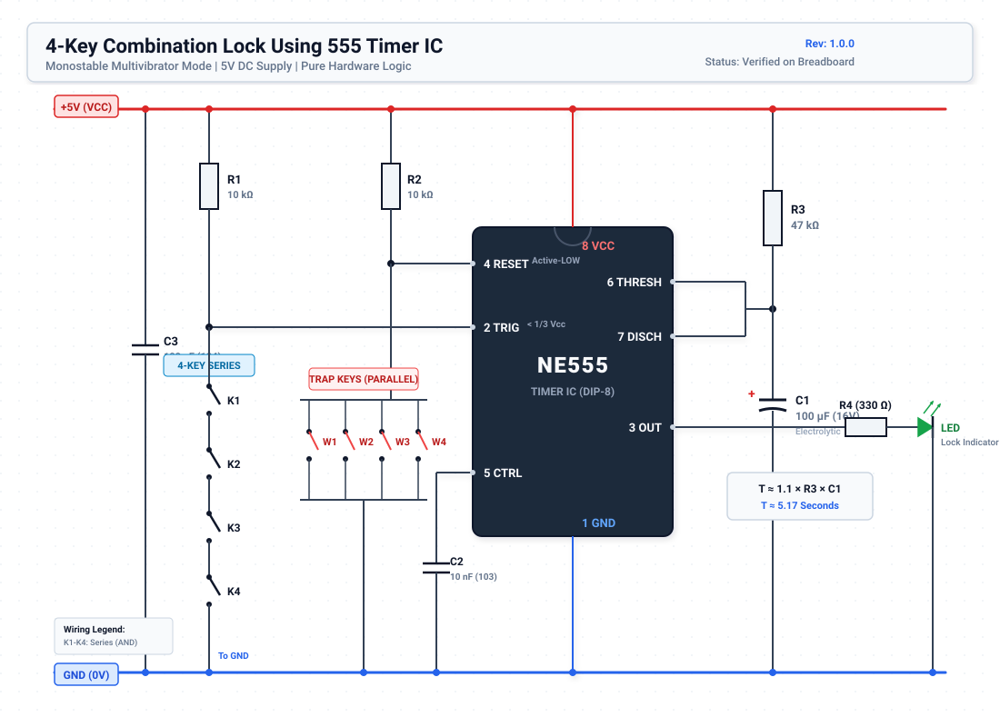

# Circuit Schematic & Theory of Operation

This document provides an in-depth engineering analysis of the **4-Key Combination Lock Using 555 Timer**, detailing circuit topology, internal IC state transitions, mathematical derivations, and electrical characteristics.

---

## 📐 Circuit Schematic Diagram



*(Vector schematic available at [`docs/schematics/circuit_schematic.svg`](./schematics/circuit_schematic.svg))*

---

## ⚡ Component & Pin Assignment Matrix

| Pin | Designator | Component / Subsystem | Direct Connection | Electrical Role & Logic Behavior |
| :---: | :--- | :--- | :--- | :--- |
| **1** | **GND** | Ground Reference | Common Blue Rail (0V) | IC substrate and ground return reference. |
| **2** | **TRIG** | Trigger Input | $10\text{ k}\Omega$ pull-up ($R_1$) to $+5\text{V}$; Switches $K_1 \rightarrow K_2 \rightarrow K_3 \rightarrow K_4$ in series to GND | Senses active-low trigger ($V_{\text{TRIG}} < \frac{1}{3} V_{CC} \approx 1.67\text{ V}$). Held at $5\text{V}$ in standby. |
| **3** | **OUT** | Output Driver | $330\ \Omega$ ($R_4$) in series with LED Anode (+); Cathode (-) to GND | High-current push-pull output. Drives indicator LED ($\approx 5.15\text{ mA}$) for $T \approx 5.17\text{ s}$. |
| **4** | **RESET** | Master Reset / Trap | $10\text{ k}\Omega$ pull-up ($R_2$) to $+5\text{V}$; Switches $W_1, W_2, W_3, W_4$ in parallel to GND | Active-low master reset ($V_{\text{RESET}} < 0.7\text{ V}$). Immediately terminates pulse and forces Pin 3 LOW. |
| **5** | **CTRL** | Control Voltage Decoupling | $10\text{ nF}$ ceramic capacitor ($C_2$, marked `103`) to GND | Filters high-frequency supply ripple from internal $\frac{2}{3} V_{CC}$ reference ladder. |
| **6** | **THRESH** | Threshold Comparator | Tied to Pin 7; connected to node of $47\text{ k}\Omega$ ($R_3$) to $+5\text{V}$ and $100\ \mu\text{F}$ ($C_1$) to GND | Monitors capacitor voltage $V_C(t)$. Resets latch when $V_C \ge \frac{2}{3} V_{CC} \approx 3.33\text{ V}$. |
| **7** | **DISCH** | Capacitor Discharge Transistor | Tied to Pin 6 and timing node ($R_3 - C_1$) | Open-collector NPN transistor. Sinks timing capacitor charge to ground when latch is in RESET state. |
| **8** | **VCC** | Power Supply Input | Common Red Rail ($+5\text{V}$ DC) | Regulated supply input ($4.5\text{V} - 15\text{V}$ operating range for NE555). |
| **—** | **C3** | Rail Decoupling | $100\text{ nF}$ ceramic capacitor ($C_3$, marked `104`) across $+5\text{V}$ and GND | Suppresses shoot-through current spikes during totem-pole switching transitions. |

---

## 🔬 Internal Architecture of the 555 Timer

The classic NE555 timer IC consists of:
1. **Three matched $5\text{ k}\Omega$ resistors** in series from $V_{CC}$ to GND, establishing two stable internal voltage reference nodes:
   - Upper reference: $V_{\text{upper}} = \frac{2}{3} V_{CC} \approx 3.33\text{ V}$ (fed to Comparator 1 inverting input).
   - Lower reference: $V_{\text{lower}} = \frac{1}{3} V_{CC} \approx 1.67\text{ V}$ (fed to Comparator 2 non-inverting input).
2. **Comparator 1 (Threshold)**: Compares Pin 6 ($V_{\text{THRESH}}$) against $\frac{2}{3} V_{CC}$. If $V_{\text{THRESH}} > \frac{2}{3} V_{CC}$, output goes HIGH, setting the internal latch to Reset ($R$).
3. **Comparator 2 (Trigger)**: Compares Pin 2 ($V_{\text{TRIG}}$) against $\frac{1}{3} V_{CC}$. If $V_{\text{TRIG}} < \frac{1}{3} V_{CC}$, output goes HIGH, setting the internal latch ($S$).
4. **RS Flip-Flop**: Stores the state of the timer. Pin 4 (RESET) directly connects to the active-low asynchronous reset of this flip-flop.
5. **Discharge Transistor ($Q_1$)**: Controlled by the inverted flip-flop output $\overline{Q}$. When the latch is RESET, $Q_1$ is saturated ON, shorting Pin 7 to GND. When SET, $Q_1$ is cut OFF.
6. **Output Stage**: An inverting totem-pole driver capable of sourcing or sinking up to $200\text{ mA}$.

```
                  +5V (Pin 8)
                     │
                    [5k]
                     ├────── Reference: 2/3 Vcc (3.33V) ──── (-) Comp 1
                    [5k]                                         │
Pin 5 (Control) ─────┤                                           ├─ [ R ] ─── Output Driver ── Pin 3 (OUT)
                    [5k]                                         │  [   ]
                     ├────── Reference: 1/3 Vcc (1.67V) ──── (+) Comp 2  [LATCH]
                     │                                           │  [ S ] ─── Transistor Q1 ── Pin 7 (DISCH)
                  GND (Pin 1)                                    │
                                                           Pin 4 (RESET)
```

---

## ⏱️ Detailed Mathematical Derivation of Timing Pulse

In monostable mode, the 555 timer produces an output pulse whose width $T$ is governed purely by the charging time of capacitor $C_1$ through resistor $R_3$.

### Step 1: Exponential Charging Equation
When triggered, discharge transistor $Q_1$ opens. Current flows from $V_{CC}$ through $R_3$ to charge capacitor $C_1$. The instantaneous voltage across $C_1$ as a function of time $t$ is given by:

$$V_C(t) = V_{CC} \left( 1 - e^{-\frac{t}{R_3 C_1}} \right)$$

### Step 2: Comparator Threshold Crossing
The pulse terminates when the capacitor voltage reaches the threshold of Comparator 1, which is internally fixed at $\frac{2}{3} V_{CC}$:

$$V_C(T) = \frac{2}{3} V_{CC}$$

### Step 3: Solving for Duration $T$
Substitute into the charging equation:

$$\frac{2}{3} V_{CC} = V_{CC} \left( 1 - e^{-\frac{T}{R_3 C_1}} \right)$$

Divide both sides by $V_{CC}$:

$$\frac{2}{3} = 1 - e^{-\frac{T}{R_3 C_1}}$$

Rearrange to isolate the exponential term:

$$e^{-\frac{T}{R_3 C_1}} = 1 - \frac{2}{3} = \frac{1}{3}$$

Take the natural logarithm ($\ln$) of both sides:

$$-\frac{T}{R_3 C_1} = \ln\left(\frac{1}{3}\right) = -\ln(3)$$

Multiply by $-R_3 C_1$:

$$T = R_3 \cdot C_1 \cdot \ln(3)$$

Since $\ln(3) \approx 1.098612 \approx 1.1$:

$$T \approx 1.1 \times R_3 \times C_1$$

### Step 4: Numerical Calculation with Chosen Components
- $R_3 = 47\text{ k}\Omega = 47 \times 10^3\ \Omega$
- $C_1 = 100\ \mu\text{F} = 100 \times 10^{-6}\text{ F}$

$$T = 1.098612 \times (47 \times 10^3) \times (100 \times 10^{-6})$$
$$T = 1.098612 \times 4.7 \approx \mathbf{5.163\text{ seconds}} \approx \mathbf{5.17\text{ s}}$$

---

## 🔒 Logic Analysis: Series Entry vs. Parallel Trap

### 1. Valid Combination Logic (Series Circuit)
The trigger pin (Pin 2) is pulled to $+5\text{V}$ through $R_1$ ($10\text{ k}\Omega$). Between Pin 2 and Ground lies a series daisy-chain of 4 tactile pushbuttons:

$$\text{Trigger Condition} = K_1 \land K_2 \land K_3 \land K_4$$

- If any single switch remains open, the DC path to ground is broken:
  $$V_{\text{PIN2}} = 5\text{V} > \frac{1}{3} V_{CC} \quad \implies \quad \text{No Trigger}$$
- When all 4 switches are closed simultaneously:
  $$V_{\text{PIN2}} = 0\text{V} < 1.67\text{V} \quad \implies \quad \text{Comparator 2 fires, Latch SET, Output goes HIGH}$$

### 2. Trap / Reset Logic (Parallel Circuit)
The master reset pin (Pin 4) is pulled up to $+5\text{V}$ through $R_2$ ($10\text{ k}\Omega$). Between Pin 4 and Ground lies a parallel network of 4 decoy switches:

$$\text{Reset Condition} = W_1 \lor W_2 \lor W_3 \lor W_4$$

- Pin 4 requires $V_{\text{RESET}} < 0.7\text{ V}$ to assert.
- If an intruder presses **any** of $W_1, W_2, W_3,$ or $W_4$, Pin 4 is immediately shorted to $0\text{V}$.
- **Hardware Priority:** The internal reset line overrides the trigger comparator unconditionally. Even if all combination switches ($K_1–K_4$) are pressed at the exact same instant, pressing a single wrong key drops Pin 4 low, keeping the latch RESET and the lock securely closed.

---

## 💡 Output Stage & Actuator Drive Capability

The NE555 output stage (Pin 3) drives an indicator LED with a $330\ \Omega$ current-limiting resistor ($R_4$).

### LED Forward Current:
For a standard high-efficiency blue/green LED with forward voltage $V_F \approx 2.0\text{V} - 2.8\text{V}$ and 555 output high voltage $V_{OH} \approx V_{CC} - 1.3\text{V} = 3.7\text{V}$ (typical bipolar NE555 voltage drop):

$$I_{\text{LED}} = \frac{V_{OH} - V_F}{R_4} = \frac{3.7\text{V} - 2.0\text{V}}{330\ \Omega} = \frac{1.7\text{V}}{330\ \Omega} \approx 5.15\text{ mA}$$

This provides bright optical indication while drawing minimal supply current. For driving physical electromagnetic strikes, relays, or solenoids, refer to the [Solenoid & Relay Driver Extension Guide](../README.md#optional-solenoid--relay-driver-circuit).
